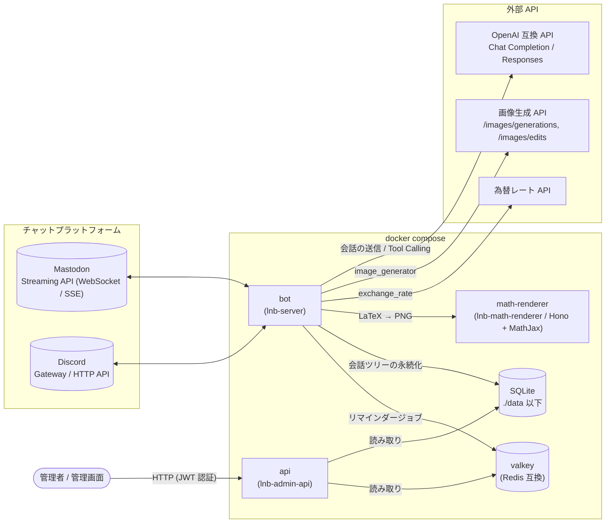
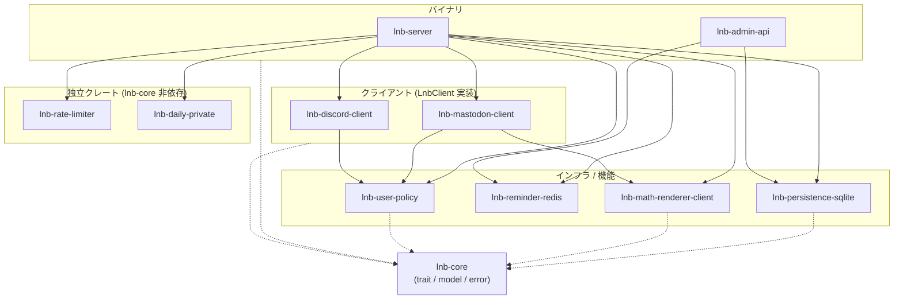
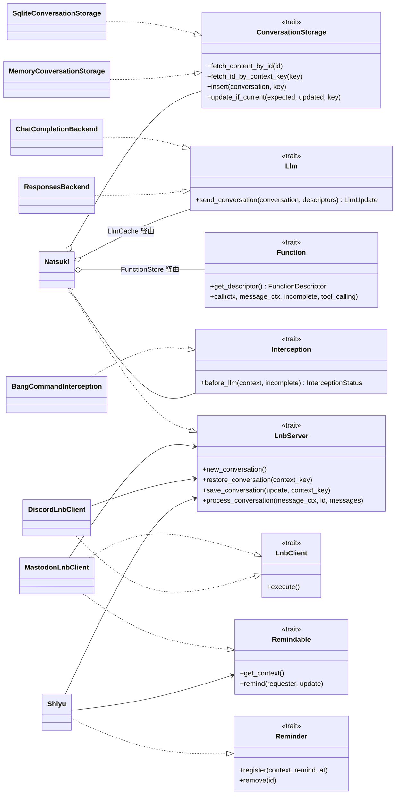
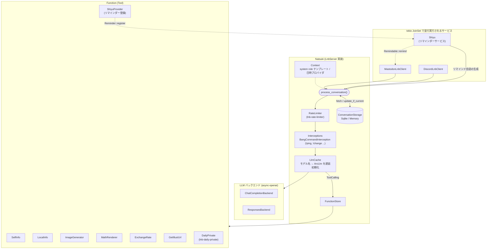
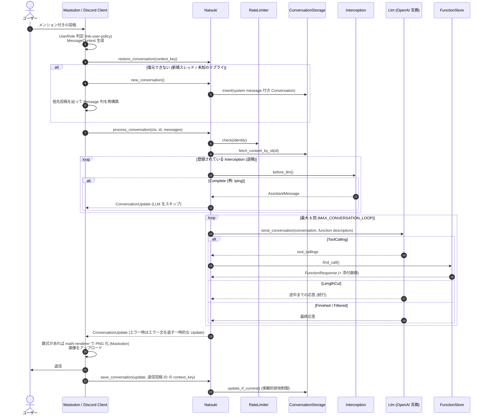
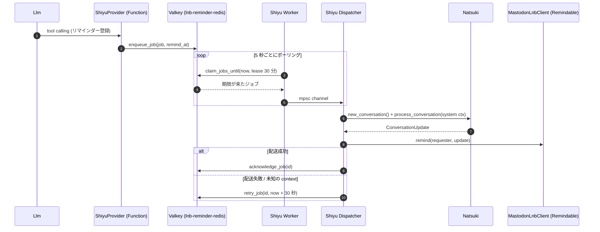

# アーキテクチャ

llm-natsuki-bot (メカ夏稀) の全体構成をまとめたドキュメントです。図はすべて Mermaid で書かれているので、GitHub 上でそのまま描画されます。

## 1. システム全体図

`compose.yaml` で起動される 4 つのサービスと、外部サービスとの関係です。

| サービス | 実装 | 役割 |
| --- | --- | --- |
| `bot` | `lnb-server` (Rust) | 本体。各プラットフォームのクライアントと会話処理エンジンを同居させて動かす |
| `api` | `lnb-admin-api` (Rust / axum) | 会話ログやリマインダーを参照する管理用 REST API |
| `math-renderer` | `lnb-math-renderer` (TypeScript / Hono + MathJax) | LaTeX 数式を PNG にレンダリングする HTTP サービス |
| `valkey` | Valkey | リマインダー (Shiyu) のジョブキュー |

## 2. クレート依存関係

Cargo workspace 内のクレートの依存関係です。`lnb-core` がトレイトとモデルを定義し、各クレートはその実装を提供する、というポート & アダプタ的な構成になっています。点線は `lnb-core` への依存です (サブグラフからの点線は、その中の全クレートが依存していることを表します)。

> `lnb-rate-limiter` / `lnb-daily-private` / `lnb-reminder-redis` は `lnb-core` に依存しない汎用クレートです。`lnb-reminder-redis` が `Reminder` トレイトを直接実装しているわけではなく、`lnb-server` 側の `Shiyu` がそれをラップしています。
>
> `xtask` は開発用タスクランナー (`cargo xtask`) なので図からは省いています。

### `lnb-core` が定義する主要なインターフェース

## 3. `lnb-server` の内部構成

`main.rs` の `initialize_natsuki()` で組み立てられるコンポーネントです。

`f4`〜`f8` は設定ファイルに対応するセクションがある場合のみ有効になるオプショナルな Function です。

## 4. メッセージ処理シーケンス

ユーザーがボットにメンションしてから返信が届くまでの流れです (`NatsukiInner::process_conversation`)。

## 5. リマインダー (Shiyu) の流れ

LLM が `ShiyuProvider` Function を呼ぶとジョブが Valkey に積まれ、時刻になると `Shiyu` がそれを取り出して会話を生成し、`Remindable` なクライアント経由で通知します。

